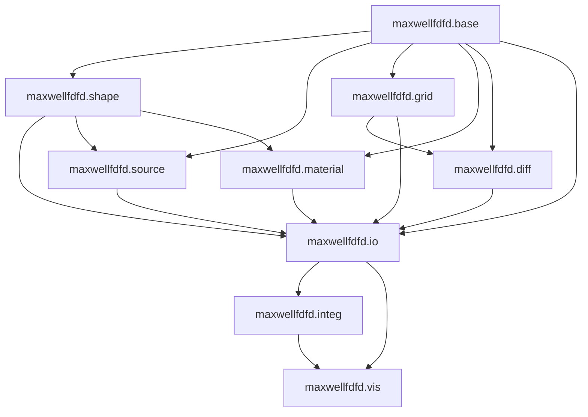

# MaxwellFDFD Python Package Architecture

## Overview

This document describes the architecture for converting the MaxwellFDFD MATLAB library to Python. MaxwellFDFD is a finite-difference frequency-domain (FDFD) solver for Maxwell's equations.

## Package Structure

```
maxwellfdfd-python/
├── maxwellfdfd/
│   ├── __init__.py
│   ├── base/
│   │   ├── __init__.py
│   │   ├── enumerations.py      # All enum classes
│   │   ├── oscillation.py       # Oscillation class
│   │   ├── equation_type.py     # EquationType class
│   │   ├── phys_unit.py         # PhysUnit class
│   │   ├── phys_c.py            # Physical constants
│   │   └── utils.py             # Utility functions (chkarg, expand2mat, etc.)
│   ├── shape/
│   │   ├── __init__.py
│   │   ├── base.py              # Shape base class
│   │   ├── interval.py          # Interval class
│   │   ├── box.py               # Box class
│   │   ├── rectangle.py         # Rectangle class
│   │   ├── point.py             # Point class
│   │   ├── line.py              # Line class
│   │   ├── plane.py             # Plane class
│   │   ├── sphere.py            # Sphere class
│   │   ├── cylinder.py          # Generic cylinder base
│   │   ├── circular_cylinder.py # CircularCylinder class
│   │   ├── elliptic_cylinder.py # EllipticCylinder class
│   │   ├── sectoral_cylinder.py # SectoralCylinder class
│   │   ├── segmental_cylinder.py# SegmentalCylinder class
│   │   ├── polygonal_cylinder.py# PolygonalCylinder class
│   │   ├── circular_shell_cylinder.py # CircularShellCylinder class
│   │   ├── ellipsoid.py         # Ellipsoid class
│   │   ├── domain.py            # Domain class
│   │   ├── zero_vol_shape.py    # ZeroVolShape class
│   │   └── utils.py             # Shape utilities (periodize_shape)
│   ├── source/
│   │   ├── __init__.py
│   │   ├── base.py              # Source base class
│   │   ├── point_src.py         # PointSrc class
│   │   ├── line_src.py          # LineSrc class
│   │   ├── rect_src.py          # RectSrc class
│   │   ├── plane_src.py         # PlaneSrc class
│   │   ├── modal_src.py         # ModalSrc class
│   │   ├── tfsf_plane_src.py    # TFSFPlaneSrc class
│   │   ├── with_bloch.py        # WithBloch mixin
│   │   └── utils.py             # Source utilities (assign_source, ind_for_loc)
│   ├── grid/
│   │   ├── __init__.py
│   │   ├── grid1d.py            # Grid1d class
│   │   ├── grid2d.py            # Grid2d class
│   │   ├── grid3d.py            # Grid3d class
│   │   └── utils.py             # Grid generation utilities
│   ├── material/
│   │   ├── __init__.py
│   │   ├── material.py          # Material class
│   │   └── utils.py             # Material assignment utilities
│   ├── diff/
│   │   ├── __init__.py
│   │   ├── matrix_equation.py   # MatrixEquation class
│   │   ├── create_curls.py      # Curl operators
│   │   ├── create_divs.py       # Divergence operators
│   │   ├── create_ds.py         # Ds operators
│   │   ├── create_dw.py         # Dw operators
│   │   ├── create_masks.py      # Mask creation
│   │   ├── eh_from_eh.py        # Field transformation
│   │   ├── solve_direct.py      # Direct solver
│   │   └── solve_iterative.py   # Iterative solver
│   ├── io/
│   │   ├── __init__.py
│   │   ├── maxwell_run.py       # Main solver interface
│   │   ├── em_object.py         # EMObject class
│   │   ├── scalar2d.py          # Scalar2d class
│   │   ├── scalar3d.py          # Scalar3d class
│   │   ├── build_system.py      # System building
│   │   ├── array2scalar.py      # Array conversion
│   │   ├── cell2array.py        # Cell to array conversion
│   │   ├── collapse_complex.py  # Complex number handling
│   │   ├── expand_complex.py    # Complex number expansion
│   │   ├── expand_node_array.py # Node array expansion
│   │   ├── fds.py               # FDS operations
│   │   ├── flip_array.py        # Array flipping
│   │   ├── flip_vec.py          # Vector flipping
│   │   ├── generate_s_factor.py # PML s-factor generation
│   │   ├── mult_vec.py          # Vector multiplication
│   │   ├── neg_vec.py           # Vector negation
│   │   ├── div_vec.py           # Vector division
│   │   ├── real_cell.py         # Real cell operations
│   │   ├── reordering_indices.py # Index reordering
│   │   ├── slice_scalar3d.py    # Scalar3d slicing
│   │   ├── transform_gt.py      # Grid type transformation
│   │   ├── vec2amp.py           # Vector to amplitude conversion
│   │   ├── read_grid.py         # Grid reading
│   │   ├── read_output.py       # Output reading
│   │   ├── write_input.py       # Input writing
│   │   └── prog_mark.py         # Progress marking
│   ├── integ/
│   │   ├── __init__.py
│   │   ├── flux_box.py          # Box flux integration
│   │   ├── flux_patch.py        # Patch flux integration
│   │   ├── linteg.py            # Line integration
│   │   ├── powerflux_box.py     # Box power flux
│   │   ├── powerflux_patch.py   # Patch power flux
│   │   └── poynting.py          # Poynting vector
│   ├── vis/
│   │   ├── __init__.py
│   │   ├── vis2d.py             # 2D visualization
│   │   ├── vis3d.py             # 3D visualization
│   │   └── visall.py            # All visualization
│   └── utils/
│       ├── __init__.py
│       ├── validation.py        # Input validation
│       └── helpers.py           # Helper functions
├── examples/
│   ├── __init__.py
│   ├── 2d/
│   │   ├── slit_2d.py
│   │   └── vis_utils.py
│   └── 3d/
│       ├── coax.py
│       ├── slot_3d.py
│       └── ...
├── tests/
│   ├── __init__.py
│   ├── conftest.py
│   ├── test_base/
│   │   ├── test_enumerations.py
│   │   ├── test_oscillation.py
│   │   └── ...
│   ├── test_shape/
│   │   ├── test_box.py
│   │   ├── test_interval.py
│   │   └── ...
│   ├── test_source/
│   ├── test_grid/
│   ├── test_material/
│   ├── test_diff/
│   ├── test_io/
│   └── test_integ/
├── docs/
│   ├── README.md
│   ├── api.md
│   ├── examples.md
│   └── conversion_notes.md
├── pyproject.toml
├── setup.py
├── requirements.txt
├── LICENSE
├── README.md
└── .gitignore
```

## Module Dependencies



## Module Organization

### base Module

**Purpose**: Provides fundamental enumerations, classes, and utility functions used throughout the package.

**Public API**:
- `Axis` enum: Cartesian axes (x, y, z)
- `BC` enum: Boundary conditions (e, m, p)
- `Dir` enum: Directions (h, v)
- `GT` enum: Grid types (prim, dual)
- `PhysQ` enum: Physical quantities
- `PML` enum: PML types (sc, u)
- `Sign` enum: Signs (n, p)
- `FT` enum: Field types (e, h)
- `Oscillation` class: Frequency information
- `EquationType` class: Equation type definition
- `PhysUnit` class: Physical unit handling
- `PhysC` class: Physical constants

**Internal Implementation**:
- `_chkarg()`: Argument validation
- `_expand2mat()`: Expand to matrix
- `_expand2row()`: Expand to row
- `_is2dlike()`: Check if 2D-like
- `_isexpandable2mat()`: Check if expandable to matrix
- `_isexpandable2row()`: Check if expandable to row
- `_isphysQcell()`: Check if physical quantity cell
- `_istypeof()`: Check type
- `_istypesizeof()`: Check type and size
- `_create_spdiag()`: Create sparse diagonal

**Conversion Notes**:
- MATLAB's `Enumerated` base class becomes Python's `enum.Enum`
- Static methods `elems()` and `count()` become class methods
- `int()` conversion becomes `value` attribute
- `char()` conversion becomes `name` attribute
- 1-based indexing converted to 0-based

### shape Module

**Purpose**: Defines geometric shapes for defining simulation domains and objects.

**Class Hierarchy**:
```
Shape (ABC)
├── Interval
├── Box
├── Rectangle
├── Point
├── Line
├── Plane
├── Sphere
├── Ellipsoid
├── GenericCylinder (ABC)
│   ├── CircularCylinder
│   ├── EllipticCylinder
│   ├── SectoralCylinder
│   ├── SegmentalCylinder
│   ├── PolygonalCylinder
│   └── CircularShellCylinder
├── Domain
└── ZeroVolShape
```

**Public API**:
- `Shape`: Abstract base class for all shapes
- `Box`: 3D box shape
- `Rectangle`: 2D rectangle shape
- `Interval`: 1D interval shape
- `Point`: Point shape
- `Line`: Line shape
- `Plane`: Plane shape
- `Sphere`: Sphere shape
- `Ellipsoid`: Ellipsoid shape
- `CircularCylinder`: Circular cylinder
- `EllipticCylinder`: Elliptic cylinder
- `SectoralCylinder`: Sectoral cylinder
- `SegmentalCylinder`: Segmental cylinder
- `PolygonalCylinder`: Polygonal cylinder
- `CircularShellCylinder`: Circular shell cylinder
- `Domain`: Domain shape
- `ZeroVolShape`: Zero-volume shape

**Key Methods**:
- `contains()`: Check if point is inside shape
- `circumbox_contains()`: Check if point is in circumbox
- `get_lprim()`: Get primary grid locations
- `get_bound()`: Get bounding box
- `get_cb_center()`: Get circumbox center
- `get_L()`: Get circumbox dimensions
- `get_dl_max()`: Get maximum grid cell size

**Conversion Notes**:
- MATLAB's `matlab.mixin.Heterogeneous` becomes Python's `ABC`
- Level set functions become callable Python functions
- Cell arrays become lists or tuples
- Properties become `@property` decorators

### source Module

**Purpose**: Defines electromagnetic sources for exciting fields in the simulation.

**Class Hierarchy**:
```
Source (ABC)
├── PointSrc
├── LineSrc
├── RectSrc
├── PlaneSrc
├── ModalSrc
└── TFSFPlaneSrc

WithBloch (Mixin)
```

**Public API**:
- `Source`: Abstract base class for all sources
- `PointSrc`: Point source
- `LineSrc`: Line source
- `RectSrc`: Rectangular source
- `PlaneSrc`: Plane wave source
- `ModalSrc`: Modal source
- `TFSFPlaneSrc`: TFSF plane wave source
- `WithBloch`: Mixin for Bloch boundary conditions

**Key Methods**:
- `generate()`: Generate source distribution
- `generate_kernel()`: Generate source kernel (abstract)
- `set_gridtype()`: Set grid type
- `get_l()`: Get grid locations

**Conversion Notes**:
- Abstract methods become `@abstractmethod`
- Mixin pattern preserved with multiple inheritance
- Cell arrays become lists

### grid Module

**Purpose**: Defines staggered grid structures for finite-difference discretization.

**Class Hierarchy**:
```
Grid1d
├── Grid2d
└── Grid3d
```

**Public API**:
- `Grid1d`: 1D grid
- `Grid2d`: 2D grid
- `Grid3d`: 3D grid

**Key Properties**:
- `axis`: Axis of the grid
- `unit`: Physical unit
- `l`: Grid locations (primary and dual)
- `dl`: Grid cell sizes
- `bc`: Boundary conditions
- `N`: Number of grid cells
- `L`: Length of grid
- `Npml`: PML cell counts
- `lpml`: PML interface locations
- `Lpml`: PML thicknesses
- `center`: Grid center

**Key Methods**:
- `set_kBloch()`: Set Bloch wave vector
- `get_lg()`: Get grid with ghost vertices
- `get_lall()`: Get grid with all vertices
- `get_bound()`: Get grid bounds

**Conversion Notes**:
- Cell arrays for `l` become dictionaries with GT enum keys
- 1-based indexing converted to 0-based
- Properties become `@property` decorators

### material Module

**Purpose**: Defines electromagnetic materials with permittivity and permeability.

**Public API**:
- `Material`: Material class

**Key Properties**:
- `eps`: Electric permittivity (scalar, vector, or tensor)
- `mu`: Magnetic permeability (scalar, vector, or tensor)
- `name`: Material name
- `color`: Material color for visualization

**Key Methods**:
- `has_iso_eps()`: Check if isotropic permittivity
- `has_iso_mu()`: Check if isotropic permeability
- `is_iso()`: Check if isotropic

**Conversion Notes**:
- Tensor representation uses numpy arrays
- Optional arguments handled with `**kwargs`

### diff Module

**Purpose**: Implements finite-difference operators and equation solvers.

**Public API**:
- `MatrixEquation`: Matrix equation class
- `create_curls()`: Create curl operators
- `create_divs()`: Create divergence operators
- `create_Ds()`: Create Ds operators
- `create_Dw()`: Create Dw operators
- `create_masks()`: Create masks
- `eh_from_eh()`: Transform fields
- `solve_eq_direct()`: Direct solver
- `solve_eq_iterative()`: Iterative solver

**Key Methods**:
- `matrix_op()`: Get matrix operation
- `solve()`: Solve equation

**Conversion Notes**:
- Sparse matrices use `scipy.sparse`
- Matrix operations use scipy.sparse.linalg

### io Module

**Purpose**: Provides main solver interface and data structures.

**Public API**:
- `maxwell_run()`: Main solver function
- `EMObject`: Electromagnetic object (shape + material)
- `Scalar2d`: 2D scalar field
- `Scalar3d`: 3D scalar field

**maxwell_run() Signature**:
```python
def maxwell_run(
    osc: Oscillation | tuple[float, float],
    dom: Domain | tuple,
    obj: list[EMObject | tuple],
    src: list[Source],
    inspect_only: bool = False
) -> tuple[list[Scalar3d], list[Scalar3d]] | tuple[list[Scalar3d], list[Scalar3d], list[EMObject], list[Source], dict]:
```

**Parameter Groups**:
- **OSC**: Oscillation parameters
  - `L0, wvlen` or `osc` instance
- **DOM**: Domain parameters
  - `material, box, dl, bc, Lpml, [deg_pml, [R_pml]], [withuniformgrid]`
  - or `domain, dl, bc, Lpml, [deg_pml, [R_pml]], [withuniformgrid]`
- **OBJ**: Object parameters
  - List of `(material, shape)` tuples or `EMObject` instances
- **SRC**: Source parameters
  - List of `Source` instances

**Conversion Notes**:
- Variable arguments use `*args` and `**kwargs`
- Cell arrays become lists
- Structure returns become dictionaries or dataclasses

### integ Module

**Purpose**: Provides integration utilities for field analysis.

**Public API**:
- `flux_box()`: Calculate flux through box
- `flux_patch()`: Calculate flux through patch
- `linteg()`: Line integration
- `powerflux_box()`: Calculate power flux through box
- `powerflux_patch()`: Calculate power flux through patch
- `poynting()`: Calculate Poynting vector

### vis Module

**Purpose**: Provides visualization utilities.

**Public API**:
- `vis2d()`: 2D visualization
- `vis3d()`: 3D visualization
- `visall()`: Visualize all components

**Conversion Notes**:
- Use matplotlib for 2D visualization
- Use mayavi or plotly for 3D visualization

## Class Hierarchy Design

### Enumerations

All enumerations inherit from `enum.Enum`:

```python
from enum import Enum, auto

class Axis(Enum):
    X = 'x'
    Y = 'y'
    Z = 'z'
    
    @classmethod
    def elems(cls, ind=None):
        elems_list = list(cls)
        if ind is not None:
            return elems_list[ind]
        return elems_list
    
    @classmethod
    def count(cls):
        return len(cls)
    
    def cycle(self):
        """Return cyclic permutation [p, q, r] with r == self."""
        idx = self.value
        p = cls.elems((idx) % cls.count())
        q = cls.elems((idx + 1) % cls.count())
        r = self
        return p, q, r
    
    def alter(self):
        """Get orthogonal axis."""
        return self.elems((self.value + 1) % 3)
```

### Shapes

Base shape class:

```python
from abc import ABC, abstractmethod
from typing import Callable, List, Tuple
import numpy as np

class Shape(ABC):
    def __init__(
        self,
        lprim_cell: List[np.ndarray],
        lsf: Callable[[np.ndarray, np.ndarray, np.ndarray], np.ndarray],
        dl_max: float = np.inf
    ):
        self._lprim_cell = lprim_cell
        self._lsf = lsf
        self._dl_max = dl_max
        self._interval = []
        for axis in Axis:
            self._interval.append(Interval(lprim_cell[axis.value], dl_max[axis.value]))
        self.n_subpxls = 10
    
    @property
    def lprim(self) -> List[np.ndarray]:
        return [interval.lprim for interval in self._interval]
    
    @property
    def bound(self) -> np.ndarray:
        return np.array([interval.bound for interval in self._interval])
    
    @property
    def cb_center(self) -> np.ndarray:
        return np.mean(self.bound, axis=1)
    
    @property
    def L(self) -> np.ndarray:
        return np.array([interval.L for interval in self._interval])
    
    @property
    def dl_max(self) -> np.ndarray:
        return np.array([interval.dl_max for interval in self._interval])
    
    def circumbox_contains(self, x: np.ndarray, y: np.ndarray, z: np.ndarray) -> np.ndarray:
        truth = np.ones_like(x, dtype=bool)
        loc = [x, y, z]
        for axis in Axis:
            truth &= self._interval[axis.value].contains(loc[axis.value])
        return truth
```

### Sources

Base source class:

```python
from abc import ABC, abstractmethod
from typing import List, Tuple, Dict

class Source(ABC):
    def __init__(
        self,
        lgrid_cell: List[np.ndarray],
        laltgrid_cell: List[np.ndarray],
        shape: Shape,
        forceprim: bool = False
    ):
        self._lgrid = lgrid_cell
        self._laltgrid = laltgrid_cell
        self._shape = shape
        self._gt = None
        self._forceprim = forceprim
    
    def set_gridtype(self, gt: GT) -> None:
        self._gt = gt
    
    @property
    def l(self) -> Dict[GT, List[np.ndarray]]:
        l = {gt: [] for gt in GT}
        if self._forceprim:
            l[GT.PRIM] = self._lgrid
            l[GT.DUAL] = self._laltgrid
        else:
            l[self._gt] = self._lgrid
            l[self._gt.alter()] = self._laltgrid
        return l
    
    @abstractmethod
    def generate_kernel(
        self,
        w_axis: Axis,
        grid3d: Grid3d
    ) -> Tuple[List[np.ndarray], np.ndarray]:
        pass
    
    def generate(
        self,
        w_axis: Axis,
        grid3d: Grid3d
    ) -> Tuple[List[np.ndarray], np.ndarray]:
        return self.generate_kernel(w_axis, grid3d)
```

### Grids

Grid1d class:

```python
from typing import Dict, List, Tuple
import numpy as np

class Grid1d:
    def __init__(
        self,
        axis: Axis,
        unit: PhysUnit,
        lprim_array: np.ndarray,
        Npml_array: np.ndarray,
        bc: BC
    ):
        self._axis = axis
        self._unit = unit
        self._unitvalue = unit.value(PhysQ.L)
        self._Npml = Npml_array
        self._bc = bc
        
        self._lprim = lprim_array
        self._N = len(lprim_array) - 1
        self._L = lprim_array[-1] - lprim_array[0]
        
        # Calculate dual grid
        self._ldual = np.zeros(self._N + 1)
        self._ldual[1:] = (lprim_array[:-1] + lprim_array[1:]) / 2
        
        if bc == BC.P:
            self._ldual[0] = self._ldual[-1] - self._L
            self._ldual_ext = self._ldual[1] + self._L
        else:
            self._ldual[0] = lprim_array[0] - (self._ldual[1] - lprim_array[0])
            self._ldual_ext = lprim_array[-1] + (lprim_array[-1] - self._ldual[-1])
        
        self._l = {
            GT.PRIM: lprim_array[:-1],
            GT.DUAL: self._ldual[1:]
        }
        
        self._dl = {
            GT.PRIM: np.diff(self._ldual),
            GT.DUAL: np.diff(lprim_array)
        }
        
        self._lpml = np.array([
            lprim_array[self._Npml[Sign.NEGATIVE.value]],
            lprim_array[-1 - self._Npml[Sign.POSITIVE.value]]
        ])
        self._Lpml = np.array([
            self._lpml[0] - lprim_array[0],
            lprim_array[-1] - self._lpml[1]
        ])
        self._center = np.mean(self._lpml)
        
        self._kBloch = 0.0
    
    @property
    def axis(self) -> Axis:
        return self._axis
    
    @property
    def unit(self) -> PhysUnit:
        return self._unit
    
    @property
    def unitvalue(self) -> float:
        return self._unitvalue
    
    @property
    def l(self) -> Dict[GT, np.ndarray]:
        return self._l
    
    @property
    def dl(self) -> Dict[GT, np.ndarray]:
        return self._dl
    
    @property
    def bc(self) -> BC:
        return self._bc
    
    @property
    def N(self) -> int:
        return self._N
    
    @property
    def L(self) -> float:
        return self._L
    
    @property
    def Npml(self) -> np.ndarray:
        return self._Npml
    
    @property
    def lpml(self) -> np.ndarray:
        return self._lpml
    
    @property
    def Lpml(self) -> np.ndarray:
        return self._Lpml
    
    @property
    def center(self) -> float:
        return self._center
    
    def set_kBloch(self, bloch_src: WithBloch) -> None:
        self._kBloch = bloch_src.kBloch(self._axis)
```

### Materials

Material class:

```python
from typing import Union
import numpy as np

class Material:
    def __init__(
        self,
        name: str,
        color: Union[str, Tuple[float, float, float]],
        eps: Union[complex, np.ndarray],
        mu: Union[complex, np.ndarray] = 1.0,
        islossless: bool = False
    ):
        self.name = name
        self.color = color
        self._islossless = islossless
        
        # Convert eps to 3x3 tensor
        self._eps = self._to_tensor(eps)
        self._mu = self._to_tensor(mu)
    
    @staticmethod
    def _to_tensor(value: Union[complex, np.ndarray]) -> np.ndarray:
        if np.isscalar(value):
            return np.diag([value, value, value])
        elif value.ndim == 1:
            return np.diag(value)
        elif value.shape == (3, 3):
            return value
        elif value.shape == (3, 6):
            S = value[:, 3:]
            eps = value[:, :3]
            return S @ eps @ S.T
        else:
            raise ValueError("Invalid tensor shape")
    
    @property
    def eps(self) -> np.ndarray:
        if self._islossless:
            return np.real(self._eps)
        return self._eps
    
    @property
    def mu(self) -> np.ndarray:
        if self._islossless:
            return np.real(self._mu)
        return self._mu
    
    @property
    def has_iso_eps(self) -> bool:
        return np.allclose(self._eps, np.diag(np.diag(self._eps)))
    
    @property
    def has_iso_mu(self) -> bool:
        return np.allclose(self._mu, np.diag(np.diag(self._mu)))
    
    @property
    def is_iso(self) -> bool:
        return self.has_iso_eps and self.has_iso_mu
```

### Main Solver Interface

maxwell_run function:

```python
from typing import List, Tuple, Union, Optional, Dict, Any

def maxwell_run(
    *args,
    inspect_only: bool = False
) -> Union[
    Tuple[List[Scalar3d], List[Scalar3d]],
    Tuple[List[Scalar3d], List[Scalar3d], List[EMObject], List[Source]],
    Tuple[List[Scalar3d], List[Scalar3d], List[EMObject], List[Source], Dict[str, Any]]
]:
    """
    Run MaxwellFDFD solver.
    
    Parameters
    ----------
    *args : Variable arguments
        OSC, DOM, OBJ, SRC parameter groups
    inspect_only : bool, optional
        If True, run without launching solver
    
    Returns
    -------
    E_cell : List[Scalar3d]
        E-field components
    H_cell : List[Scalar3d]
        H-field components
    obj_array : List[EMObject], optional
        Objects in simulation domain
    src_array : List[Source], optional
        Sources in simulation domain
    extra : Dict[str, Any], optional
        Extra information (grid3d, J, M, eps, mu)
    """
    # Parse input arguments
    osc, dom, obj_list, src_list = _parse_arguments(args)
    
    # Build simulation domain
    grid3d, eps_cell, mu_cell, s_factor_cell = _build_system(dom, obj_list, osc)
    
    # Assign sources
    J_cell, M_cell = _assign_sources(src_list, grid3d)
    
    if inspect_only:
        return None
    
    # Create matrix equation
    eqtype = EquationType(FT.E, GT.PRIM)
    pml = dom.get('pml', PML.SC)
    omega = osc.in_omega0()
    
    matrix_eq = MatrixEquation(eqtype, pml, omega, eps_cell, mu_cell, s_factor_cell, J_cell, M_cell, grid3d)
    
    # Solve equation
    A, b = matrix_eq.matrix_op()
    f = solve_eq_direct(A, b)
    
    # Extract fields
    E_cell, H_cell = _extract_fields(f, grid3d, matrix_eq)
    
    return E_cell, H_cell
```

## Package Configuration

### pyproject.toml

```toml
[build-system]
requires = ["setuptools>=45", "wheel", "setuptools_scm[toml]>=6.2"]
build-backend = "setuptools.build_meta"

[project]
name = "maxwellfdfd"
description = "Finite-difference frequency-domain solver for Maxwell's equations"
readme = "README.md"
requires-python = ">=3.8"
license = {text = "MIT"}
authors = [
    {name = "MaxwellFDFD Contributors"}
]
keywords = ["FDFD", "Maxwell", "electromagnetics", "FDTD"]
classifiers = [
    "Development Status :: 4 - Beta",
    "Intended Audience :: Science/Research",
    "License :: OSI Approved :: MIT License",
    "Programming Language :: Python :: 3",
    "Programming Language :: Python :: 3.8",
    "Programming Language :: Python :: 3.9",
    "Programming Language :: Python :: 3.10",
    "Programming Language :: Python :: 3.11",
    "Topic :: Scientific/Engineering :: Physics",
]
dependencies = [
    "numpy>=1.20.0",
    "scipy>=1.7.0",
    "matplotlib>=3.3.0",
]
dynamic = ["version"]

[project.optional-dependencies]
dev = [
    "pytest>=7.0.0",
    "pytest-cov>=3.0.0",
    "black>=22.0.0",
    "flake8>=4.0.0",
    "mypy>=0.950",
    "sphinx>=4.5.0",
    "sphinx-rtd-theme>=1.0.0",
]
vis3d = [
    "mayavi>=4.7.0",
    "pyvista>=0.35.0",
]
iterative = [
    "petsc4py>=3.16.0",
]

[project.urls]
Homepage = "https://github.com/maxwellfdfd/maxwellfdfd-python"
Documentation = "https://maxwellfdfd.readthedocs.io"
Repository = "https://github.com/maxwellfdfd/maxwellfdfd-python"
Issues = "https://github.com/maxwellfdfd/maxwellfdfd-python/issues"

[tool.setuptools_scm]
write_to = "maxwellfdfd/_version.py"

[tool.black]
line-length = 100
target-version = ['py38']

[tool.mypy]
python_version = "3.8"
warn_return_any = true
warn_unused_configs = true
disallow_untyped_defs = false

[tool.pytest.ini_options]
testpaths = ["tests"]
python_files = ["test_*.py"]
python_classes = ["Test*"]
python_functions = ["test_*"]
```

### requirements.txt

```
numpy>=1.20.0
scipy>=1.7.0
matplotlib>=3.3.0
```

### setup.py

```python
from setuptools import setup

setup()
```

### __init__.py Files

**maxwellfdfd/__init__.py**:
```python
"""
MaxwellFDFD: Finite-difference frequency-domain solver for Maxwell's equations.
"""

from maxwellfdfd._version import __version__

# Core imports
from maxwellfdfd.base import (
    Axis, BC, Dir, GT, PhysQ, PML, Sign, FT,
    Oscillation, EquationType, PhysUnit, PhysC
)
from maxwellfdfd.shape import (
    Shape, Box, Rectangle, Interval, Point, Line, Plane,
    Sphere, Ellipsoid, CircularCylinder, EllipticCylinder,
    SectoralCylinder, SegmentalCylinder, PolygonalCylinder,
    CircularShellCylinder, Domain, ZeroVolShape
)
from maxwellfdfd.source import (
    Source, PointSrc, LineSrc, RectSrc, PlaneSrc,
    ModalSrc, TFSFPlaneSrc, WithBloch
)
from maxwellfdfd.grid import Grid1d, Grid2d, Grid3d
from maxwellfdfd.material import Material
from maxwellfdfd.io import (
    maxwell_run, EMObject, Scalar2d, Scalar3d
)

__all__ = [
    '__version__',
    # Base
    'Axis', 'BC', 'Dir', 'GT', 'PhysQ', 'PML', 'Sign', 'FT',
    'Oscillation', 'EquationType', 'PhysUnit', 'PhysC',
    # Shapes
    'Shape', 'Box', 'Rectangle', 'Interval', 'Point', 'Line', 'Plane',
    'Sphere', 'Ellipsoid', 'CircularCylinder', 'EllipticCylinder',
    'SectoralCylinder', 'SegmentalCylinder', 'PolygonalCylinder',
    'CircularShellCylinder', 'Domain', 'ZeroVolShape',
    # Sources
    'Source', 'PointSrc', 'LineSrc', 'RectSrc', 'PlaneSrc',
    'ModalSrc', 'TFSFPlaneSrc', 'WithBloch',
    # Grids
    'Grid1d', 'Grid2d', 'Grid3d',
    # Materials
    'Material',
    # IO
    'maxwell_run', 'EMObject', 'Scalar2d', 'Scalar3d',
]
```

## Key Design Decisions

### 1. Enumeration Design
- Use Python's `enum.Enum` instead of MATLAB's classdef enumeration
- Implement `elems()` and `count()` as class methods
- Use `value` attribute for integer conversion
- Use `name` attribute for string conversion

### 2. Shape Hierarchy
- Use Abstract Base Classes (ABC) for abstract methods
- Preserve heterogeneous container pattern using Union types
- Level set functions become callable Python functions
- Use numpy arrays for vectorized operations

### 3. Source Design
- Abstract methods use `@abstractmethod` decorator
- Mixin pattern preserved for WithBloch
- Cell arrays become Python lists or dictionaries

### 4. Grid Design
- Use dictionaries with enum keys for cell arrays
- Properties use `@property` decorator
- Preserve staggered grid structure

### 5. Material Design
- Tensor representation uses numpy arrays
- Support scalar, vector, and tensor inputs
- Optional arguments handled with default values

### 6. Solver Interface
- Variable arguments use `*args` and `**kwargs`
- Parameter parsing done in helper functions
- Return multiple values using tuples

### 7. Module Organization
- Each MATLAB directory becomes a Python package
- Related classes grouped in same module
- Utilities separated into utils modules
- Clear separation between public API and internal implementation

### 8. Type Hints
- Use Python type hints throughout
- Define custom types for complex structures
- Use Union for multiple possible types
- Use Optional for nullable values

### 9. Testing Structure
- Mirror package structure in tests
- Use pytest for testing framework
- Separate unit tests from integration tests
- Include fixtures in conftest.py

### 10. Documentation
- Use docstrings for all public APIs
- Include type information in docstrings
- Provide examples in docstrings
- Separate API documentation from user guide

## Conversion Notes by Module

### base Module
- **Enumerated**: Convert to `enum.Enum`
- **chkarg**: Convert to Python validation functions
- **expand2mat/expand2row**: Convert to numpy operations
- **1-based indexing**: Convert to 0-based throughout

### shape Module
- **Heterogeneous**: Use Union types and ABC
- **Level set functions**: Convert to Python callables
- **Cell arrays**: Convert to lists/tuples
- **Properties**: Use `@property` decorator

### source Module
- **Abstract methods**: Use `@abstractmethod`
- **Mixins**: Preserve with multiple inheritance
- **Cell arrays**: Convert to lists/dictionaries

### grid Module
- **Cell arrays**: Use dictionaries with enum keys
- **Properties**: Use `@property` decorator
- **1-based indexing**: Convert to 0-based

### material Module
- **Tensor operations**: Use numpy
- **Optional arguments**: Use default values
- **Type checking**: Use isinstance()

### diff Module
- **Sparse matrices**: Use scipy.sparse
- **Matrix operations**: Use scipy.sparse.linalg
- **Cell arrays**: Convert to lists

### io Module
- **Variable arguments**: Use *args, **kwargs
- **Cell arrays**: Convert to lists
- **Structures**: Use dataclasses or dictionaries
- **maxwell_run**: Preserve flexible argument parsing

## Dependencies

### Core Dependencies
- **numpy**: Array operations and numerical computing
- **scipy**: Sparse matrices and linear algebra
- **matplotlib**: Visualization

### Optional Dependencies
- **mayavi/pyvista**: 3D visualization
- **petsc4py**: Iterative solvers
- **pytest**: Testing
- **sphinx**: Documentation

## Migration Path

### Stage 1: Core Infrastructure
1. Implement base module (enumerations, utilities)
2. Implement shape module (base Shape class)
3. Implement grid module (Grid1d, Grid2d, Grid3d)

### Stage 2: Physics Components
1. Implement material module
2. Implement source module (base Source class)
3. Implement diff module (operators)

### Stage 3: Solver Interface
1. Implement io module (data structures)
2. Implement maxwell_run function
3. Implement integ module

### Stage 4: Visualization and Testing
1. Implement vis module
2. Write comprehensive tests
3. Create examples
4. Write documentation

## Testing Strategy

### Unit Tests
- Test each enumeration
- Test each shape class
- Test each source class
- Test grid generation
- Test material properties
- Test diff operators

### Integration Tests
- Test maxwell_run with simple cases
- Test 2D examples
- Test 3D examples
- Test boundary conditions
- Test PML

### Validation Tests
- Compare with MATLAB results
- Test convergence
- Test known analytical solutions

## Future Enhancements

1. **GPU Support**: Add CUDA support for accelerated computation
2. **Parallel Computing**: Add MPI support for large-scale simulations
3. **Advanced Materials**: Support dispersive and nonlinear materials
4. **Adaptive Meshing**: Implement adaptive grid refinement
5. **Machine Learning**: Add ML-based optimization
6. **Cloud Integration**: Support cloud computing platforms

## Conclusion

This architecture provides a solid foundation for converting MaxwellFDFD from MATLAB to Python. The design preserves the core functionality while leveraging Python's strengths in scientific computing. The modular structure allows for incremental development and testing.